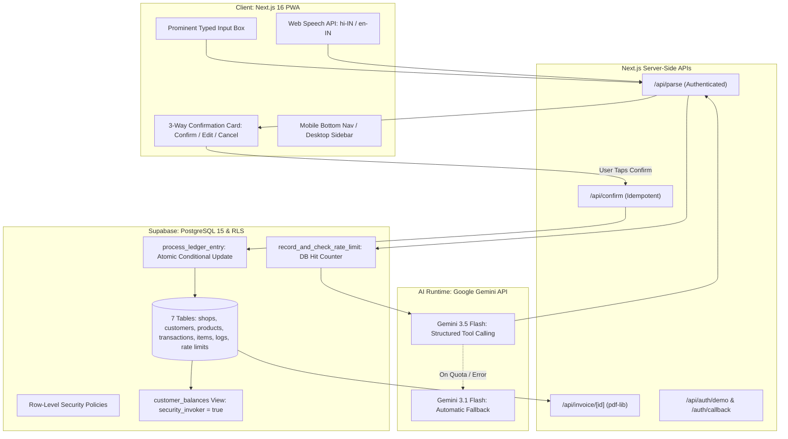

# DukaanAI

> **"Talk to your shop. DukaanAI keeps the books."**  
> *A voice-first Hinglish AI co-pilot for 13M+ Indian kirana store owners.*

[](https://dukaanai-two.vercel.app)
[](https://dukaanai-two.vercel.app)
[](https://nextjs.org/)
[](https://ai.google.dev/)
[](https://supabase.com/)

---

## Live Application Links

| Destination | URL | Description |
| :--- | :--- | :--- |
| **Main Live Website** | [https://dukaanai-two.vercel.app](https://dukaanai-two.vercel.app) | Landing page with code-built 3D hero scene, scroll story, and live demo access |
| **Direct App Access** | [https://dukaanai-two.vercel.app/app](https://dukaanai-two.vercel.app/app) | Kirana shopkeeper dashboard, voice input, digital ledger, and stock tracking |
| **Sign In / Demo** | [https://dukaanai-two.vercel.app/login](https://dukaanai-two.vercel.app/login) | Google OAuth Sign-In or 1-Click Instant Demo Login (no signup needed) |
| **Production Alias** | [https://dukaanai-himanshu-rawat.vercel.app](https://dukaanai-himanshu-rawat.vercel.app) | Verified Vercel production alias |
| **AI Usage Report** | [AI_USAGE.md](AI_USAGE.md) | Full prompt log, architecture decisions, tools used, errors caught, and test metrics |
| **Demo Video** | [Watch Demo Video (3-5 min)](https://dukaanai-two.vercel.app) | *Video walkthrough placeholder for HackIndia judges* |

---

## The Problem

India is home to over **13 million small kirana grocery stores** powering daily community commerce. 

- **Physical Constraints:** Shopkeepers work 14–16 hour days with their hands constantly occupied weighing grains, packing spices, handling cash, and serving a steady line of customers.
- **Lost Revenue in Paper Ledgers:** Over **₹3.5 Lakhs** is typically locked in untracked informal credit (*udhar*) scrawled across torn paper notebooks (*bahi-khata*). Pages rip, customer names blur, and debt settlements are forgotten.
- **Complex Software Abandonment:** Modern accounting applications (Khatabook, OkCredit, Vyapar) require manual typing, navigating nested dropdowns, and searching product catalogs on small phone screens. Kirana owners abandon them during peak evening rush hours when they are needed most.

---

## The Solution

**DukaanAI** is a voice-first, Hinglish AI business co-pilot tailored to the physical reality of the Indian kirana counter.

Instead of typing numbers into tiny form fields, the shopkeeper taps a single button and speaks naturally in everyday Hinglish:
> *"Ramesh ne 500 ka saaman liya, 200 abhi diye"*  
> *(Ramesh bought Rs 500 worth of groceries, paid Rs 200 now)*

The server-side **Parser Agent** (powered by Google Gemini function calling) extracts the customer name, line items, quantities, and payment breakdown. A high-contrast **3-Way Confirmation Card** displays the structured result for instant shopkeeper verification. Upon confirmation, the **Ledger Agent** atomically updates the customer balance, decrements matched inventory in PostgreSQL, and generates an instant GST-compliant PDF invoice and 1-tap WhatsApp payment reminder link.

---

## Accurate Feature List

All features listed below are fully implemented and verified in the codebase:

1. **Voice-First & Typed Kirana Entry**
   - Built with the native browser Web Speech API (`SPEECH_LANG = "en-IN"`) to transcribe natural spoken Hindi and Hinglish into clean Roman characters in real time.
   - Includes a prominent typed-input box that works equally well across all browsers and desktop environments without requiring microphone permissions.

2. **AI Parser Agent with Gemini Structured Function Calling**
   - Server-side tool calling via `@google/genai` executing four core schemas: `add_sale`, `record_payment`, `adjust_stock`, and `add_customer`.
   - Recognizes Hindi/Hinglish numbers in words ("paanch sau" = 500, "dedh sau" = 150, "dhai sau" = 250, "ek hazaar" = 1000).
   - Extracts colloquial quantities and fractions ("do packet", "aadha kilo", "dedh kilo", "ek dozen").
   - Computes confidence scores (0.0 to 1.0) and generates plain English transaction summaries.

3. **3-Way Confirmation Card (Confirm / Edit / Cancel)**
   - Strict human-in-the-loop guarantee: **zero entries are saved to the database without explicit user confirmation**.
   - Displays action badges, full customer names, itemized breakdowns, total/paid/udhar amounts, and low-confidence visual warnings (< 0.70).
   - Action-specific customer disambiguation: displays candidates when names are ambiguous; allows new customer creation on credit sales; enforces existing debtor selection on payment repayments.
   - Inline edit mode allows instant modifications to totals, items, and customer names before saving.
   - Per-parse UUID idempotency keys prevent duplicate transaction recording upon network retries or repeated button presses.

4. **Digital Customer Ledger (Khata) & Detail Statements**
   - Real-time customer balances computed directly in PostgreSQL views (`customer_balances`) with Row-Level Security (`WITH security_invoker = true`).
   - Customer search, sortable balances, aggregate debt statistics, and chronological transaction history cards.
   - Master-detail split layout on desktop screens ($\ge 1024\text{px}$) with dedicated customer statements.

5. **GST-Ready Instant PDF Invoices**
   - On-demand server route `GET /api/invoice/[transactionId]` generating clean, printable GST-style receipts using `pdf-lib`.
   - Displays shop name, GSTIN, invoice number, customer name, IST date/time, itemized grocery list, total amount, paid cash, and outstanding balance.
   - Client and server-side ASCII text sanitization ensures standard fonts render currency amounts without encoding crashes.

6. **1-Tap WhatsApp Payment Reminders**
   - One-tap "Remind" button on debtor cards generating polite, localized Roman-Hinglish payment reminder drafts:
     > *"Namaste Ramesh ji, aapka Rs 300 udhar baaki hai. Please jaldi bhej dijiye. - Sharma Kirana Store"*
   - Normalizes Indian phone numbers to 12 digits (`91XXXXXXXXXX`) and launches `wa.me` deep-links with pre-filled text. Zero AI calls consumed.

7. **Live Inventory Tracking & Low-Stock Alerts**
   - Kirana product matcher with alias mapping (`atta/aata`, `doodh/milk`, `chini/sugar`, `tel/oil`, `namak/salt`, `chawal/rice`).
   - Distinguishes generic categories from specific variants (e.g., bare "dal" prompts a candidate picker among stocked dals; "toor dal" matches directly).
   - Detects measurement unit mismatches (e.g., spoken `kg` vs stocked `packet`).
   - Matched items atomically decrement inventory in PostgreSQL during sales via conditional SQL updates (`WHERE stock_qty >= q`).
   - Automatic dashboard alerts when `stock_qty <= reorder_level`.
   - 1-tap manual restock shortcuts and interactive supplier reorder draft generator calculating suggested restock quantities.

8. **Shop Profile & Settings Customization**
   - Editable shop name and standard 15-character uppercase GSTIN saved directly to the database.
   - 1-tap "Add Demo Stock Items" button with case-insensitive deduplication to easily populate realistic inventory.

9. **Cinematic Landing Page with Code-Built 3D Hero Scene**
   - Midnight dark aesthetic (`#070611`), glowing violet/indigo ambient halos, and saffron accents.
   - Code-built Three.js / React Three Fiber visual: emissive voice orb, 64-bar animated waveform ring pulsing to harmonic sine sums, deterministic particle field, and 3 floating ledger cards.
   - Strict 5-point hardware guard (WebGL2, hardware concurrency, no reduced motion) falling back seamlessly to a high-performance CSS visual.
   - Lenis smooth scrolling and GSAP ScrollTrigger section reveals isolated strictly to the landing route.

10. **Mobile-First & Desktop Master-Detail Layouts**
    - High-contrast, warm paper theme on `/app` optimized for readability under bright sunlight.
    - All touch targets strictly $\ge 48\text{px}$ for effortless counter use.
    - Responsive layout transitions smoothly from single-column mobile view to 2-column desktop dashboard and master-detail ledger.

---

## Architecture



---

## Live Demo & Judge Instructions

### Zero-Friction Demo Access
HackIndia judges can explore the complete application without creating an account:

1. Navigate to the live application: **[https://dukaanai-two.vercel.app](https://dukaanai-two.vercel.app)**
2. Click **"Try demo"** on the landing page or visit `/login` and click **"1-Click Demo Login"**.
3. You will be signed in instantly as `demo@dukaanai.in` to **"Sharma Kirana Store"**, pre-seeded with:
   - **15 realistic Indian customers** with phone numbers and localized notes.
   - **30 grocery products** across common Kirana categories with realistic prices and low-stock alerts.
   - **90 days of transactions** with Hinglish transcripts and itemized links.

*(Alternatively, sign in with your personal Google account. On an empty shop dashboard, click **"Add Demo Stock Items"** in Settings to populate your shop with sample inventory in one click).*

### Spoken / Typed Test Queries to Try:
- **Credit Sale with Partial Cash:**
  > `"Ramesh ne 500 ka saaman liya, 200 abhi diye"`  
  *(Parses sale: Total ₹500, Paid ₹200, Udhar ₹300 for customer Ramesh Kumar)*
- **Debt Repayment:**
  > `"Ramesh ne 300 jama karwaye"`  
  *(Parses payment: ₹300 credited against Ramesh's existing udhar balance)*
- **Sale with Line Items & Stock Decrement:**
  > `"Suresh ko 2 packet doodh aur ek kilo chini udhar di"`  
  *(Parses line items: matches milk and sugar, displays stock before -> after preview, updates inventory atomically)*
- **Stock Restock:**
  > `"Atta 10 packet restock karo"`  
  *(Parses adjust_stock: increments Aashirvaad Atta inventory by 10 units)*

---

## Setup Steps & Environment Variables

### Prerequisites
- Node.js 20+ (Node.js 22 recommended)
- Supabase project
- Google Gemini API key

### 1. Clone the Repository
```bash
git clone https://github.com/HackIndiaXYZ/ai-first-startup-hackathon-build-a-startup-using-ai-only-radiant.git dukaanai
cd dukaanai
```

### 2. Install Dependencies
```bash
npm install
```

### 3. Configure Environment Variables
Copy `.env.example` to `.env.local`:
```bash
cp .env.example .env.local
```

Populate the required environment variable names (do not commit secrets):
```env
NEXT_PUBLIC_SUPABASE_URL=
NEXT_PUBLIC_SUPABASE_ANON_KEY=
SUPABASE_SERVICE_ROLE_KEY=
GEMINI_API_KEY=
LLM_MODEL=gemini-3.5-flash-lite
LLM_FALLBACK_MODEL=gemini-3.1-flash-lite
DEMO_USER_EMAIL=demo@dukaanai.in
DEMO_USER_PASSWORD=
AI_DAILY_CAP=200
```

### 4. Apply Database Migrations & Seed Data
Execute the SQL migration files in `supabase/migrations/` sequentially in your Supabase SQL Editor:
- `001_init.sql` (Tables, RLS policies, customer_balances view)
- `002_ledger.sql` (process_ledger_entry procedure, rate_limit_hits table)
- `003_demo_onboarding.sql` (Sample data onboarding helper)
- `004_sale_stock.sql` (Atomic conditional stock decrements)

Then seed the demo store:
```bash
npm run seed
```

### 5. Start Development Server
```bash
npm run dev
```
Open [http://localhost:3000](http://localhost:3000) in your browser.

---

## Security & Architectural Guarantees

- **Row-Level Security (RLS) Isolation:** Every database table (`shops`, `customers`, `products`, `transactions`, `transaction_items`, `agent_logs`, `rate_limit_hits`) enforces PostgreSQL RLS policies checking `is_shop_owner(shop_id)`. Shopkeepers can never query or mutate another store's financial records.
- **Confirm-Before-Save Guarantee:** Zero AI-parsed transactions are written to the database automatically. The human shopkeeper must inspect and explicitly confirm the parsed card before any database insert or balance calculation occurs.
- **Single-Transaction Idempotency:** Every confirmation request requires a client-generated UUID `idempotency_key`. A database unique constraint on `(shop_id, idempotency_key)` prevents double-charging or duplicate entries upon connection retries.
- **Database-Backed Rate Limiting:** Rate limit hits are recorded in the `rate_limit_hits` table *prior* to executing Gemini API calls. Prevents API budget exhaustion by enforcing 10 req/min per user, 15 req/min per IP, and a global daily cap (`AI_DAILY_CAP`).
- **Zero Client Secret Exposure:** The Google Gemini API key and Supabase service-role keys are strictly server-only. No AI endpoints or service keys are accessible from the browser bundle.
- **Prompt Injection Defense:** The Parser system prompt includes strict isolation instructions directing the model to ignore any user text attempting to override schemas or system directives.

---

## Automated Verification & Test Suite

The repository features comprehensive automated test coverage with **311 offline tests across 88 suites**:

```bash
# Run 311 offline unit, integration, and security tests (< 1.5s runtime)
npm test

# Run ESLint validation
npm run lint

# Run Next.js production build validation
npm run build

# Run automated scan ensuring zero Devanagari characters in source code
python3 -c "import pathlib,re;h=[(str(p),i) for p in pathlib.Path('src').rglob('*') if p.is_file() and p.suffix in('.ts','.tsx','.css','.json','.md') for i,l in enumerate(p.read_text(errors='ignore').splitlines(),1) if re.search('[\u0900-\u097F]',l)];print('TOTAL HITS:',len(h))"

# Run optional live AI smoke test against real Gemini API
npm run smoke:ai
```

---

## Limitations and Next Steps

In the interest of full transparency and honesty, the following capabilities outlined in preliminary ideation are **not implemented** in the current production deployment:

1. **Photo Import (OCR Bill Scanning):** Camera photo scanning of handwritten paper ledger pages or supplier paper receipts (Tier 3 in BRIEF.md) is not built. Currently, transactions must be entered via voice or typed input.
2. **Dedicated AI Morning Briefing Screen:** A standalone LLM-narrated daily briefing screen with generative business advice was not implemented. Instead, actionable shop metrics (today's collections, total market udhar, top 5 debtors, and low-stock alerts) are computed deterministically on the main dashboard.
3. **Automated WhatsApp Bot Messaging:** DukaanAI does not use the official WhatsApp Business Cloud API (which requires business registration and per-template message fees). Instead, it generates deep-linked `wa.me` links with pre-filled text that the shopkeeper reviews and sends with one tap.
4. **Text-to-Speech (TTS) Audio Readback:** Synthetic voice readback of ledger balances and confirmation summaries is not implemented; all feedback is visual.

---

## Team & Hackathon Details

- **Event:** **HackIndia 2026 AI-First Startup Hackathon**
- **Track:** Build a Startup Using AI Only
- **Team Name:** **RADIANT**
- **Primary Live Deployment:** [https://dukaanai-two.vercel.app](https://dukaanai-two.vercel.app)
- **Detailed Documentation:** [AI_USAGE.md](AI_USAGE.md)
